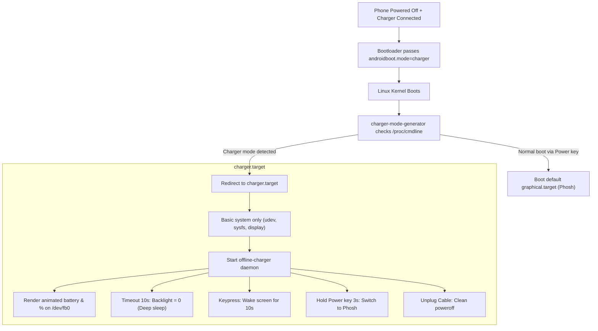

# Offline Charging Mode for Mobile Linux

A lightweight, low-power off-mode charging animation and power management daemon for Linux smartphones (Xiaomi Poco F1 `beryllium` / Qualcomm SDM845 running Kali Linux, postmarketOS, Mobian, or other systemd-based mobile distros).

---

## Overview

When an Android smartphone is powered off and connected to a USB charger, the Qualcomm bootloader (ABL) boots the Linux kernel with the command-line argument:
```
androidboot.mode=charger
```
By default on general-purpose desktop/mobile Linux distributions, `systemd` ignores this flag and boots the full desktop session (Phosh, GNOME, modem, cellular, audio, and network services). This consumes excessive power, causes the phone to heat up, and prevents normal off-mode charging behavior.

**Offline Charging Mode** solves this cleanly using a native `systemd-generator`:
1. It intercepts `androidboot.mode=charger` during early boot.
2. It diverts the boot process into an isolated, minimal `charger.target`.
3. It launches a lightweight daemon (`offline-charger`) that draws an animated battery charging screen directly to the Linux framebuffer (`/dev/fb0`) via Cairo vector graphics.
4. Heavy services (Phosh, NetworkManager, ModemManager, audio) remain completely inactive.

---

## Features

- **Hardware Boot Interceptor:** Automatically detects off-state charging via `androidboot.mode=charger`. Normal power-on boots straight into your desktop environment.
- **Minimal Resource Footprint:** Runs under an isolated `charger.target` without X11 or Wayland compositors.
- **Direct Framebuffer Rendering:** Zero-copy Cairo rendering directly to `/dev/fb0` with a true black (`#000000`) background.
- **Automatic Screen Sleep (Anti-Burn-In):** Turns off screen backlight after 10 seconds of inactivity to save power and prevent LCD/OLED image retention.
- **Smart Key Controls:**
  - **Short Press (Power / Volume):** Wakes the screen for 10 seconds to show the current battery percentage.
  - **Hold Power Key (3 Seconds):** Instantly boots into the full desktop OS (`systemctl isolate graphical.target`) without rebooting the kernel.
- **Unplug Auto-Poweroff:** If the charger cable is unplugged, displays a 3.5-second countdown and cleanly shuts down the device (`systemctl poweroff`).
- **USB-PD & PPS Telemetry:** Automatically detects USB Power Delivery (`PD`) and Programmable Power Supply (`PD_PPS`) modes, calculating and displaying real-time power metrics:
  - Negotiated Wattage ($P = V \times A$)
  - Voltage & Current (e.g. `15.0W • 5.0V / 3.0A`)
  - Battery Temperature monitoring (`38.8°C`) with high-temperature alert (> 45°C)

---

## Architecture



---

## Requirements

- **Device:** Xiaomi Poco F1 (`beryllium`) or any Qualcomm SDM845 / Linux-supported mobile device with a framebuffer (`/dev/fb0`).
- **OS:** Kali Linux, Mobian, postmarketOS (systemd), Debian Mobile, Arch ARM, or Ubuntu Touch.
- **Dependencies:**
  - `python3`
  - `python3-cairo`
  - `systemd`

---

## Installation

Clone this repository and run the installer:

```bash
git clone https://github.com/<your-username>/offline-charging.git
cd offline-charging
sudo ./install.sh
```

Or using `make`:

```bash
make install
```

The installer will:
1. Verify and install dependencies (`python3`, `python3-cairo`).
2. Copy the daemon binary to `/usr/local/bin/offline-charger`.
3. Install `offline-charger.service` and `charger.target` into `/etc/systemd/system/`.
4. Install `charger-mode-generator` into `/etc/systemd/system-generators/`.
5. Reload `systemd` and enable the service.

---

## How to Test

1. **Power off** your phone completely (`sudo systemctl poweroff`).
2. **Connect your USB charger cable**.
3. The phone will power up into the **Offline Charging Screen**:
   - The screen shows the battery outline, percentage, and charging lightning bolt.
   - After 10 seconds, the display turns off.
   - Tap the **Power** or **Volume** button to wake the screen.
   - Hold the **Power** button for 3 seconds to boot directly into Kali / Phosh.
   - Unplug the cable to power off the device.

---

## Development & Customization

The project includes development scripts in `dev/`:

### 1. Generating Preview Images
You can test and preview the battery UI rendering on your desktop without touching the device display:

```bash
python3 dev/preview.py
```
This generates preview images in `dev/previews/` (e.g. `charging_12pct.png`, `charging_65pct.png`, `charging_100pct.png`, `unplugged.png`).

### 2. Testing Hardware Inputs
To inspect power supplies and test power button / volume key event codes:

```bash
sudo python3 dev/test_inputs.py
```

### 3. Display Customization
You can customize screen dimensions and brightness via environment variables or by modifying `/usr/local/bin/offline-charger`:

| Variable | Default | Description |
| :--- | :--- | :--- |
| `OFFLINE_CHARGER_FB` | `/dev/fb0` | Path to framebuffer device |
| `OFFLINE_CHARGER_WIDTH` | `1080` | Screen width in pixels |
| `OFFLINE_CHARGER_HEIGHT` | `2246` | Screen height in pixels |
| `OFFLINE_CHARGER_STRIDE` | `4352` | Row stride in bytes |
| `OFFLINE_CHARGER_BRIGHTNESS` | `750` | Active screen backlight level |

---

## Uninstallation

To remove Offline Charging Mode completely:

```bash
sudo ./uninstall.sh
```
Or:
```bash
make uninstall
```

---

## License

This project is licensed under the [MIT License](LICENSE).
